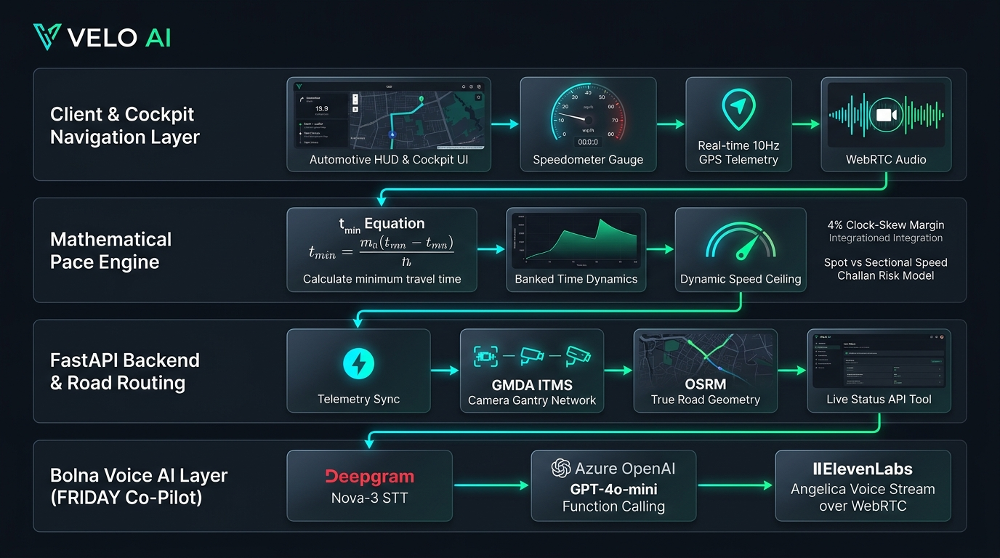
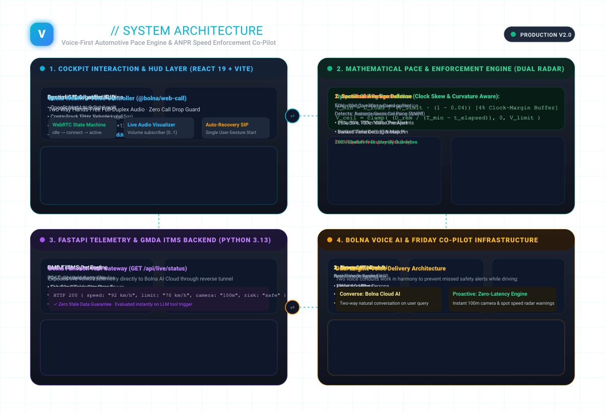

<div align="center">

# VELO AI // VOICE-FIRST PACE COACH
### Real-Time Average Speed Pacing & ANPR Radar Defense for Smart Expressways

[](https://fastapi.tiangolo.com)
[](https://react.dev)
[](https://www.typescriptlang.org)
[](https://www.bolna.ai)
[](audit_test_cases.py)
[](LICENSE)

<br/>

<p align="center">
  <b>The world's first voice-first automotive co-pilot engineered to eliminate automated speed challans across ANPR smart expressways through continuous calculus pacing and natural conversational AI.</b>
</p>

[System Architecture](#-system-architecture) •
[The $100M Problem](#-the-billion-dollar-problem) •
[Mathematical Core](#-mathematical-pace-engine) •
[Dual Challan Defense](#-dual-challan-risk-radar) •
[FRIDAY Voice AI](#-friday-voice-ai-co-pilot) •
[Quickstart](#-quickstart-guide)

---



</div>

<br/>

## 🚨 The Billion-Dollar Problem

### Why Traditional Radar Apps Fail on Modern Expressways

Every major highway authority worldwide—from the **GMDA ITMS network in Gurugram (NH-48, Dwarka Expressway, Sohna Elevated Corridor)** to UK Smart Motorways and Dubai ITS—has transitioned from isolated spot speed traps to **Automated Number Plate Recognition (ANPR) Sectional Speed Enforcement**.

| Legacy Point-in-Time Traps | Modern ANPR Sectional Enforcement |
|:---|:---|
| Single radar gun measures speed at one instant ($\Delta t \to 0$). | Gantry 1 timestamps vehicle entry; Gantry 2 timestamps vehicle exit. |
| Slow down 50m before the camera and speed right back up. | **Average speed** $\bar{v} = \frac{D_{\text{road}}}{t_{\text{exit}} - t_{\text{entry}}}$ is calculated across the entire corridor. |
| Addressed by Google Maps & RadarBot spot warnings. | **Completely defeats legacy radar apps.** Braking at the exit camera does not erase the speed debt accumulated earlier. |

#### The Driver's Dilemma
If a driver cruises at **120 km/h** for the first 3 km of a 5 km (70 km/h limit) zone, they have already mathematically exhausted their legal travel time allowance. Even if they slam the brakes to **40 km/h** right under the second camera, their average crossing velocity violates the threshold. Drivers cannot perform continuous calculus in their heads while navigating highway traffic.

---

## ⚡ The VELO AI Solution

**VELO AI** is an intelligent, voice-first automotive co-pilot that continuously computes the driver’s **dynamic legal velocity ceiling** ($V_{\text{ceil}}$) in real time. Rather than issuing passive alarms after a violation has already occurred, VELO AI prescribes the exact maximum cruise speed required over the remaining section distance to guarantee a **100% challan-free journey**.

```
[ Gantry 1 Entry ] ──── (25% CP) ──── (50% CP) ──── (75% CP) ──── [ Gantry 2 Exit ]
        │                    │              │              │                 │
    t = 0.0s             t = 150s       t = 380s       t = 600s          t = 780s
  Clock Sync           Ceiling Alert  Banked Pacing  Safe Cruise Clear  Zero Challan Passed
```

* **Continuous Pacing Math:** Real-time feedback accounting for road curvature (+12% over straight displacement) and a 4% clock-skew safety margin.
* **Dual-Risk Defense:** Protects against both **Spot Camera Crossings** (radar within 20m FOV) and **Sectional Average Corridor Enforcement**.
* **Zero Cognitive Distraction:** Fully hands-free conversational voice co-pilot (**FRIDAY**) powered by **Bolna Voice AI**, **Deepgram**, **Azure OpenAI**, and **ElevenLabs**.
* **No Unsolicited Fine Numbers:** Compliant reporting—alerts users to regional challan risk levels without presenting speculative monetary fine amounts.

---

## 📐 Mathematical Pace Engine

The core algorithmic engine computes travel time deficits and dynamic speed ceilings at 10 Hz across any arbitrary road geometry.

### 1. Minimum Legal Transit Time ($T_{\min}$)
To eliminate automated ANPR flags while factoring in clock discrepancies between municipal camera gantries and vehicle GPS, VELO AI enforces a **4% safety margin** ($\alpha = 0.04$):

$$T_{\min} = \frac{D_{\text{road}}}{V_{\text{limit}} \times (1 - \alpha)}$$

### 2. Real-Time Banked Time Balance ($t_{\text{banked}}$)
As the vehicle traverses distance $d$ over elapsed time $t$, its accumulated time credit or deficit relative to the posted speed limit is:

$$t_{\text{banked}} = t - \frac{d}{V_{\text{limit}}}$$

* **$t_{\text{banked}} > 0$ (Time Credit):** Driver traversed early stretch slowly or absorbed traffic delay.
* **$t_{\text{banked}} < 0$ (Time Debt):** Driver accelerated above legal threshold; immediate speed reduction required to amortize deficit.

### 3. Dynamic Ceiling Velocity ($V_{\text{ceil}}$)
The maximum allowable speed over the remaining distance $D_{\text{rem}} = D_{\text{road}} - d$ to guarantee exit time $t \ge T_{\min}$:

$$V_{\text{ceil}} = \min\left(V_{\text{limit}}, \frac{D_{\text{road}} - d}{T_{\min} - t}\right)$$

> **Banked Time Rule:** Even if a driver accumulates massive time credits in a traffic jam, $V_{\text{ceil}}$ is strictly capped at $V_{\text{limit}}$. VELO AI never advises exceeding legal highway signs.

### 4. Tri-State Urgency State Machine
Alert status is evaluated continuously against the vehicle's instant throttle velocity ($v$):

$$\text{Alert}(v) = \begin{cases}
\text{RED} & \text{if } v > V_{\text{ceil}} \\
\text{AMBER} & \text{if } V_{\text{ceil}} - 5.0 \le v \le V_{\text{ceil}} \\
\text{GREEN} & \text{if } v < V_{\text{ceil}} - 5.0
\end{cases}$$

---

## 🛡️ Dual Challan Risk Radar

VELO AI separates enforcement risk into two independent radar models, ensuring coverage across Indian expressways:

```
┌─────────────────────────────────────────────────────────────────────────────────┐
│                           GMDA ITMS CAMERA ROADWAY                              │
├──────────────────────────┬──────────────────────────┬───────────────────────────┤
│    SPOT RADAR ZONE       │  CORRIDOR PACING ZONE    │     SPOT RADAR ZONE       │
│  (-20m to +30m gantry)   │  (Between camera pairs)  │   (-20m to +30m gantry)   │
├──────────────────────────┼──────────────────────────┼───────────────────────────┤
│ • Instant Radar Trigger  │ • Average Section Speed  │ • Instant Radar Trigger   │
│ • Cross-Track < 85m      │ • Checkpoints (25..100%) │ • Cross-Track < 85m       │
│ • Proactive 100m Alert   │ • Dynamic Ceiling Calc   │ • Proactive 100m Alert    │
└──────────────────────────┴──────────────────────────┴───────────────────────────┘
```

1. **Spot Challan Risk (Instantaneous Gantry Radar):**
   * Monitored within a **-20m to +30m** field-of-view bounding window around every physical camera coordinate.
   * If instant velocity exceeds gantry limit: instantly records crossing infraction and sounds urgent spot hazard alert.
   * Features a **proactive 100m proximity warning**: announces upcoming camera gantry and posted limit before vehicle enters detection cone.

2. **Speed Challan Risk (Sectional Average Corridor Enforcement):**
   * Evaluated across the true traversed road alignment between consecutive ANPR gantries.
   * Checkpoints at **25%, 50%, 75%, and 100%** deliver prescriptive pace adjustments.
   * Successfully amortizing banked time debt guarantees section clearance with **Zero Challan Risk**.

---

## 🎙️ FRIDAY: Voice AI Co-Pilot

VELO AI integrates an enterprise automotive voice stack powered by **Bolna AI**:

<div align="center">
  
</div>

### Voice Architecture Pipeline
1. **Audio Capture & WebRTC Transport:**
   * Browser microphone streams low-latency full-duplex audio via `@bolna/web-call` SIP gateway.
   * Persistent 3600-second session lifecycle with auto-reconnection and zero mid-ride call drop.
2. **Streaming Speech-to-Text (ASR):**
   * **Deepgram Nova-3** performs sub-150ms streaming transcription in English and Hinglish.
3. **Autonomous Agent & Real-Time Function Calling:**
   * **Azure OpenAI GPT-4o-mini** executes as the FRIDAY co-pilot.
   * Equipped with the **`get_live_telemetry`** tool: whenever the driver asks *"What's my speed?"* or *"Any cameras ahead?"*, FRIDAY queries the live reverse tunnel (`/api/live/status`), reporting live sensor values rather than static snapshots.
4. **Neural Speech Synthesis (TTS):**
   * **ElevenLabs Turbo v2.5** streams natural, high-fidelity audio using the custom **Angelica** voice profile.
5. **Local Proactive Safety Engine:**
   * Zero-latency Web Audio API chime oscillators and proactive speech ensure that 100m camera warnings and overspeed alerts fire even during silence on the voice channel.

---

## 🗺️ GMDA ITMS Verified Camera Network

Calibrated directly against OpenStreetMap highway centerlines across the National Capital Region (Gurugram):

```
[ Shankar Chowk (Cyber Hub) ] ── (3.45 km) ──> [ Atlas Chowk Skywalk ]
              │                                          │
          (1.85 km)                                  (2.68 km)
              ▼                                          ▼
   [ Signature Tower ] ─────── (1.20 km) ──────> [ Jharsa Chowk ]
              │                                          │
          (2.85 km)                                  (12.25 km)
              ▼                                          ▼
   [ Rajiv Chowk Underpass ] ──────────────────> [ Hero Honda Chowk ] ──> [ IMT Manesar ]
```

* **Dynamic Graph Routing:** Supports any origin and destination across Gurugram Sectors 1–115, landmarks, or map clicks.
* **True Road Curvature:** Evaluates true OpenStreetMap vehicular geometries (accounting for flyovers, underpasses, and cloverleaf loops) rather than straight-line Euclidean displacement.
* **Smart Mode Switching:** Transitions between **Camera Enforcement Mode** (active pacing between gantry pairs) and **Normal Road Navigation Mode** (standard routing outside ANPR corridors).

---

## 🧪 Comprehensive Test Suite (36/36 Verified)

VELO AI includes an exhaustive audit suite verifying mathematical edge cases against the engineering specification:

```bash
$ python audit_test_cases.py
================================================================================
VELO AI - COMPREHENSIVE TEST CASE AUDIT REPORT
================================================================================
[TC-01] Sprint 1 Spec Reference Test (Doc Baseline)               [36/36 OK]
[TC-02] Aggressive Start & Voice Pace Recovery (YC Demo)          [PASS]
[TC-03] The Law-Abiding Steady Cruise (Optimal Smooth Pace)       [PASS]
[TC-04] Traffic Jam & Banked Time Rule (Ceiling Capped at Limit)  [PASS]
[TC-05] Chronic Violator / Challan Guaranteed (Extreme Overspeed) [PASS]
[TC-06] Dwarka Expressway Urban Section (10 km, 80 km/h Limit)   [PASS]
[TC-07] Amber Boundary & Edge Precision Test (5 km/h Gap)         [PASS]
[TC-08] NH-48 Urban Section (Shankar Chowk → Atlas Chowk)         [PASS]
[TC-09] Road Network Shortest Distance vs. Chord Displacement     [PASS]
================================================================================
AUDIT SUMMARY: Total: 36 | Passed: 36 | Failed: 0 (100% Accuracy)
================================================================================
```

---

## 💻 Tech Stack

| Domain | Technologies |
|:---|:---|
| **Frontend Cockpit** | React 19, TypeScript, Vite, Tailwind CSS, Lucide Icons |
| **Spatial GIS** | Leaflet, Turf.js, OSRM Highway Routing, OpenStreetMap Centerlines |
| **Voice AI Layer** | Bolna Voice AI, `@bolna/web-call` SDK, WebRTC, SIP, Web Audio API |
| **Cloud Models** | Deepgram Nova-3 (STT), Azure OpenAI GPT-4o-mini (LLM), ElevenLabs Turbo v2.5 (TTS) |
| **Backend API** | Python 3.13, FastAPI, Uvicorn, Pydantic, HTTPX, Localtunnel |
| **Architecture** | Dual-Engine Voice Delivery, Sub-50ms Telemetry Stream, Reverse Tunnel Tooling |

---

## 🚀 Quickstart Guide

### Prerequisites
* **Node.js** >= 18.x
* **Python** >= 3.11
* **Bolna API Key & Agent ID** ([platform.bolna.ai](https://platform.bolna.ai))

### 1. Clone the Repository
```bash
git clone https://github.com/SuryaPratapIIIT/VELO-AI.git
cd VELO-AI
```

### 2. Configure Environment Variables
Create `backend/.env`:
```env
PORT=8000
HOST="0.0.0.0"
ENVIRONMENT="development"
BOLNA_API_KEY="bn-your_bolna_api_key_here"
BOLNA_AGENT_ID="your_bolna_agent_id_here"
BOLNA_API_URL="https://api.bolna.ai"
SAFETY_MARGIN=0.04
AMBER_GAP_KMH=5.0
GANTRIES_FILE_PATH="./data/gantries.json"
```

Create root `.env`:
```env
VITE_BACKEND_URL="http://localhost:8000"
VITE_DEFAULT_SESSION_ID="live_ride"
VITE_BOLNA_AGENT_ID="your_bolna_agent_id_here"
```

### 3. Install Dependencies
```bash
# Frontend
npm install

# Backend
python -m pip install -r backend/requirements.txt
```

### 4. Run the Development Stack
In three separate terminal windows:

```bash
# Terminal 1: FastAPI Backend
python -m uvicorn main:app --host 0.0.0.0 --port 8000 --app-dir backend --reload

# Terminal 2: Vite Frontend Cockpit
npm run dev

# Terminal 3: Public Tool Tunnel for Bolna AI Function Calling
npx localtunnel --port 8000 --subdomain velo-live-suraj
```

Open [http://localhost:5173](http://localhost:5173) in your browser. Click **Start Navigation** or **Talk to FRIDAY** to launch the hands-free voice co-pilot.

---

## 📡 API Reference

### Telemetry & Bolna Tooling
* `POST /api/telemetry/live`: Receives sub-50ms live vehicle telemetry from client HUD.
* `GET /api/live/status`: Bolna Agent function tool endpoint. Returns real-time velocity, limit, upcoming camera distance, and regional challan risk.
* `POST /api/bolna/session`: Mints ephemeral WebRTC call session credentials via Bolna Gateway.
* `GET /api/gantries`: Returns verified GMDA ITMS gantry database.
* `GET /health`: Liveness probe and active session health check.

---

## 📄 License

Distributed under the **MIT License**. See `LICENSE` for details.

---

<div align="center">
  <sub>Engineered with precision for zero automated challans on smart expressways.</sub>
  <br/>
  <b>VELO AI © 2026</b>
</div>
