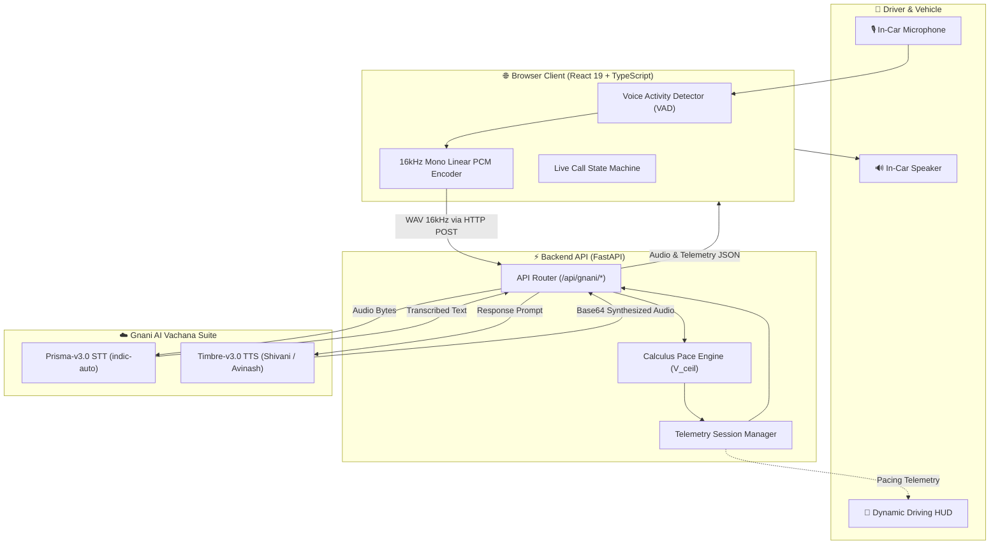

<div align="center">

# 🚗 EDITH AI
### Real-Time ANPR Sectional Speed Pacing & Automotive Voice Co-Pilot
**Built with Gnani AI Vachana Suite (Prisma-v3.0 STT & Timbre-v3.0 TTS)**

[](https://fastapi.tiangolo.com)
[](https://react.dev)
[](https://www.typescriptlang.org)
[](https://gnani.ai)
[](audit_test_cases.py)
[](LICENSE)

<br/>

<p align="center">
  <b>The world's first voice-first automotive co-pilot engineered to eliminate automated speed challans across ANPR smart expressways through continuous calculus pacing and natural multilingual conversational AI.</b>
</p>

[The Problem](#-the-billion-dollar-problem) •
[EDITH Features](#-edith-ai-features) •
[System Architecture](#-system-architecture) •
[Gnani AI Voice Suite](#-gnani-ai-voice-suite-v30) •
[Mathematical Core](#-mathematical-pace-engine) •
[Deployment Guide](#-step-by-step-deployment-guide) •
[Quickstart](#-local-quickstart-guide)

---

</div>

<br/>

## 🚨 The Billion-Dollar Problem

### Why Traditional Radar Apps Fail on Modern Expressways

Highway authorities worldwide—from the **GMDA ITMS network in Gurugram (NH-48, Dwarka Expressway, Sohna Elevated Corridor)** to UK Smart Motorways and Dubai ITS—have shifted from spot radar traps to **Automated Number Plate Recognition (ANPR) Sectional Speed Enforcement**.

| Legacy Spot Traps (Google Maps / RadarBot) | Modern ANPR Sectional Enforcement (GMDA ITMS) |
|:---|:---|
| Single radar gun measures speed at one instant ($\Delta t \to 0$). | Gantry 1 timestamps entry; Gantry 2 timestamps exit. |
| Slow down 50m before the camera and accelerate right back up. | **Average speed** $\bar{v} = \frac{D_{\text{road}}}{t_{\text{exit}} - t_{\text{entry}}}$ is calculated across the entire corridor. |
| Handled by spot warning alerts. | **Defeats legacy radar apps.** Braking at the exit camera does not erase the speed debt accumulated earlier. |

#### The Driver's Dilemma
If a driver cruises at **110 km/h** for the first 3 km of a 5 km (70 km/h limit) zone, they have already mathematically exhausted their legal travel time allowance. Even if they slam the brakes to **40 km/h** under the second camera, their average crossing velocity violates the threshold, issuing an automated challan.

---

## ⚡ EDITH AI Features

**EDITH AI** is an intelligent, voice-first automotive co-pilot that continuously computes the driver’s **dynamic legal velocity ceiling** ($V_{\text{ceil}}$) in real time. Rather than issuing passive alarms after a violation has already occurred, EDITH prescribes the exact cruise speed required over the remaining distance to guarantee a **100% challan-free journey**.

```
[ Gantry 1 Entry ] ──── (25% CP) ──── (50% CP) ──── (75% CP) ──── [ Gantry 2 Exit ]
        │                    │              │              │                 │
     t = 0.0s             t = 150s       t = 380s       t = 600s          t = 780s
   Clock Sync           Ceiling Alert  Banked Pacing  Safe Cruise Clear  Zero Challan Passed
```

* 🎙️ **Voice-First Conversational Co-Pilot (EDITH):** 100% hands-free voice interface. Drivers can ask natural Hinglish/English questions without looking away from the road.
* 📍 **Dynamic Real-Time HUD:** Live countdown to the next upcoming ANPR gantry camera with adaptive maneuver guidance and target distance meter.
* 🛡️ **Dual-Risk Defense:** Protects against both **Spot Camera Crossings** (radar within 20m FOV) and **Sectional Average Corridor Enforcement**.
* 🛑 **Instant Call Disconnect:** Drivers can cleanly end calls with natural phrases (*"Cut call from your side"*, *"Call kaat do"*, *"Disconnect"*) with immediate audio acknowledgment and mic track release.
* 📊 **Compliant Road Safety Reporting:** Alerts users to regional risk levels without speculative fine numbers.

---

## 🏗️ System Architecture



---

## 🗣️ Gnani AI Voice Suite (v3.0)

EDITH is deeply integrated with **Gnani AI Vachana Suite**:

* **Speech-to-Text (STT):** `prisma-v3.0`
  * Model: `prisma-v3.0`
  * Mode: `indic-auto` (candidates: `["hi-IN", "en-IN"]`)
  * Automotive acoustic hints for Indian highway terms (`ANPR`, `challan`, `speed limit`, `gantry`).
* **Text-to-Speech (TTS):** `timbre-v3.0`
  * Model: `timbre-v3.0`
  * Female Voice (Hindi / Hinglish): `Shivani`
  * Male Voice (English): `Avinash`
  * Low latency streaming synthesis returned as base64 audio.

### Example Spoken Interactions:
| Driver Query (Spoken) | EDITH Response (Spoken Out Loud) |
|:---|:---|
| *"Meri speed kya hai?"* | *"Aapki current speed 72 km/h hai. Is zone ki speed limit 70 km/h hai."* |
| *"Is route par total cameras kitne hain?"* | *"Is route par total 2 ANPR cameras hain. Aapne 1 cameras cross kar liye hain aur 1 camera aage bache hain. Agla camera Rajiv Chowk Underpass 1593 meter aage hai."* |
| *"Kya mera challan katega?"* | *"Aapka average pace 68 km/h hai jo 70 km/h limit ke andar hai. Safe speed maintain rakhein, challan nahi katega."* |
| *"Cut call from your side"* | *"Call cut kar rahi hoon boss, safe driving kijiye!"* *(Call immediately terminates)* |

---

## 📐 Mathematical Pace Engine

The algorithmic core computes travel time deficits and dynamic speed ceilings at 10 Hz across real-world road geometry.

### 1. Minimum Legal Transit Time ($T_{\min}$)
Enforces a **4% safety margin** ($\alpha = 0.04$) against municipal camera clock drift:

$$T_{\min} = \frac{D_{\text{road}}}{V_{\text{limit}} \times (1 - \alpha)}$$

### 2. Real-Time Banked Time Balance ($t_{\text{banked}}$)
$$t_{\text{banked}} = t - \frac{d}{V_{\text{limit}}}$$
* **$t_{\text{banked}} > 0$ (Time Credit):** Driver traversed early stretch cautiously or absorbed traffic delay.
* **$t_{\text{banked}} < 0$ (Time Debt):** Driver accelerated above legal threshold; speed reduction required.

### 3. Dynamic Ceiling Velocity ($V_{\text{ceil}}$)
Maximum allowable cruise speed over remaining distance $D_{\text{rem}} = D_{\text{road}} - d$:

$$V_{\text{ceil}} = \min\left(V_{\text{limit}}, \frac{D_{\text{road}} - d}{T_{\min} - t}\right)$$

### 4. Tri-State Urgency State Machine
$$\text{Alert}(v) = \begin{cases}
\text{RED} & \text{if } v > V_{\text{ceil}} \\
\text{AMBER} & \text{if } V_{\text{ceil}} - 5.0 \le v \le V_{\text{ceil}} \\
\text{GREEN} & \text{if } v < V_{\text{ceil}} - 5.0
\end{cases}$$

---

## 🚀 Step-by-Step Deployment Guide

Deploy the full-stack application (Frontend + Backend + Gnani AI) on **Render.com** under a single free Web Service:

### Step 1: Push Code to GitHub
```bash
git add .
git commit -m "Deploy EDITH AI"
git push origin main
```

### Step 2: Create a New Web Service on Render
1. Go to [Render Dashboard](https://dashboard.render.com/) and click **New +** $\rightarrow$ **Web Service**.
2. Select your repository: `https://github.com/SuryaPratapIIIT/Edith.git`.
3. Configure the service settings:
   * **Name:** `edith-ai`
   * **Region:** `Singapore` (Lowest latency for India)
   * **Branch:** `main`
   * **Runtime:** `Python 3`
   * **Build Command:**
     ```bash
     npm install && npm run build && pip install -r requirements.txt
     ```
   * **Start Command:**
     ```bash
     python main.py
     ```

### Step 3: Add Environment Variables in Render
In your Render Service Dashboard, navigate to **Environment** and add:

| Key | Value | Description |
|:---|:---|:---|
| `GNANI_API_KEY` | `your_gnani_api_key` | Gnani AI Vachana API Key |
| `GNANI_BASE_URL` | `https://api.vachana.ai` | Gnani Vachana endpoint |
| `GNANI_STT_MODEL` | `prisma-v3.0` | STT Model |
| `GNANI_TTS_MODEL` | `timbre-v3.0` | TTS Model |
| `GNANI_TTS_VOICE_HI`| `Shivani` | Hindi/Hinglish TTS voice |
| `GNANI_TTS_VOICE_EN`| `Avinash` | English TTS voice |
| `ENVIRONMENT` | `production` | Production mode |

4. Click **Deploy Web Service**. Your application will be live at `https://edith-ai.onrender.com` in 2-3 minutes!

---

## 💻 Local Quickstart Guide

### 1. Clone the Repository
```bash
git clone https://github.com/SuryaPratapIIIT/Edith.git
cd Edith
```

### 2. Configure Environment Variables
Create a `.env` file in the project root:
```env
PORT=8000
HOST="0.0.0.0"
ENVIRONMENT="development"

GNANI_API_KEY="your_gnani_api_key_here"
GNANI_BASE_URL="https://api.vachana.ai"
GNANI_STT_MODEL="prisma-v3.0"
GNANI_TTS_MODEL="timbre-v3.0"
GNANI_TTS_VOICE_HI="Shivani"
GNANI_TTS_VOICE_EN="Avinash"
```

### 3. Install Dependencies & Run
```bash
# Install Python packages
pip install -r requirements.txt

# Install Node modules
npm install

# Run Frontend and Backend concurrently
npm run dev
```

* **Frontend:** [http://localhost:5173/](http://localhost:5173/)
* **Backend Docs (Swagger):** [http://127.0.0.1:8000/docs](http://127.0.0.1:8000/docs)

### 4. Run Automated Test Suite
```bash
python audit_test_cases.py
python test_gnani_integration.py
```

---

## 🛡️ License & Acknowledgements
Built for **Gnani AI Hackathon 2026**.
Powered by **Gnani AI Vachana Suite**.
Licensed under the [MIT License](LICENSE).
